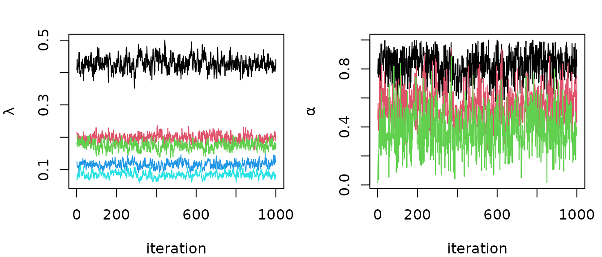

# Getting started with BayesianBenter

``` r

library(BayesianBenter)
set.seed(1)
```

## The Benter model

The Benter model (1994) is a generalization of the Plackett-Luce model
for rankings. A ranking is built sequentially: at stage $`r`$ the next
item is drawn from those still available with probability proportional
to $`\lambda_j^{\alpha_r}`$, where $`\lambda_j > 0`$ is an item’s
*worth* and $`\alpha_r \in (0, 1]`$ is a stage-specific *dampening*
(noise) exponent. Setting all $`\alpha_r = 1`$ recovers Plackett-Luce;
smaller $`\alpha_r`$ flattens the choice probabilities, encoding the
idea that rankers discriminate less sharply at later stages.

For identifiability we fix $`\alpha_1 = 1`$ and report the worths on the
sum-to-one scale.

## Simulate some rankings

``` r

lambda <- c(5, 3, 2, 1.5, 1)
lambda <- lambda / sum(lambda)
alpha  <- c(1, 0.8, 0.5, 0.3)   # length J - 1, alpha[1] = 1

pi <- rBenter(500, lambda, alpha)
head(pi)
#>      [,1] [,2] [,3] [,4] [,5]
#> [1,]    1    3    4    5    2
#> [2,]    1    5    4    3    2
#> [3,]    2    1    3    4    5
#> [4,]    3    1    5    2    4
#> [5,]    3    5    1    4    2
#> [6,]    5    1    3    2    4
```

## Fit the model

[`gibbsBenter()`](https://pearce790.github.io/BayesianBenter/reference/gibbsBenter.md)
is the single entry point. Supply the data `pi`, the number of items
`J`, the Gamma(`a`, `b`) prior on the worths, and the Beta(`c`, `d`)
prior on the dampening exponents.

``` r

fit <- gibbsBenter(pi, J = 5, a = 1, b = 1, c = 1, d = 1,
                   iters = 2000, burnin = 0.5)

rbind(truth = lambda, posterior_mean = colMeans(fit$lambda))
#>                     [,1]      [,2]      [,3]      [,4]       [,5]
#> truth          0.4000000 0.2400000 0.1600000 0.1200000 0.08000000
#> posterior_mean 0.4278881 0.1969852 0.1743369 0.1163316 0.08445811
rbind(truth = alpha,  posterior_mean = colMeans(fit$alpha))
#>                [,1]      [,2]      [,3]      [,4]
#> truth             1 0.8000000 0.5000000 0.3000000
#> posterior_mean    1 0.8265617 0.5469033 0.3759476
```

The returned object stores the posterior draws (`fit$lambda`,
`fit$alpha`) plus sampler diagnostics in `fit$parameters`.

``` r

op <- par(mfrow = c(1, 2), mar = c(4, 4, 2, 1))
matplot(fit$lambda, type = "l", lty = 1, xlab = "iteration", ylab = expression(lambda))
matplot(fit$alpha[, -1], type = "l", lty = 1, xlab = "iteration", ylab = expression(alpha))
```



``` r

par(op)
```

## Partial rankings

Partial (top-$`R`$) rankings are handled by the same function: leave the
unranked positions as `NA` (or pass a matrix with fewer than `J`
columns).

``` r

pi_partial <- pi
pi_partial[, 4:5] <- NA        # keep only the top 3 of each ranking
fit_p <- gibbsBenter(pi_partial, J = 5, a = 1, b = 1, c = 1, d = 1,
                     iters = 1000, burnin = 0.5)

# only dampening parameters up to the deepest observed rank are estimated
colMeans(fit_p$alpha)
#> [1] 1.0000000 0.8310340 0.5501744        NA
fit_p$parameters$R_obs
#> [1] 3
```

Here only the top 3 items are observed, so `alpha_4` is not identified
and is returned as `NA`; the item worths for all five items are still
estimated.

## A note on interval calibration

Credible intervals from this sampler are Bayesian, and their frequentist
coverage is only guaranteed asymptotically. In finite samples with many
items, short rankings, or widely-separated worths, coverage can fall
below nominal because the induced Dirichlet prior on the normalized
worths is informative (its strength grows with `J`) and because extreme
worths sit near the boundary of the simplex. Reducing `a` toward or
below 1 lessens the prior’s influence on the normalized weights;
checking coverage on a log-worth scale is often better calibrated near
the boundary.
